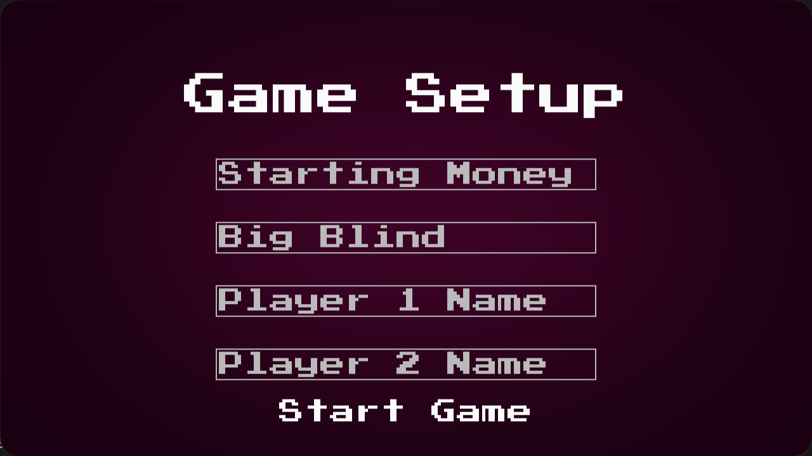
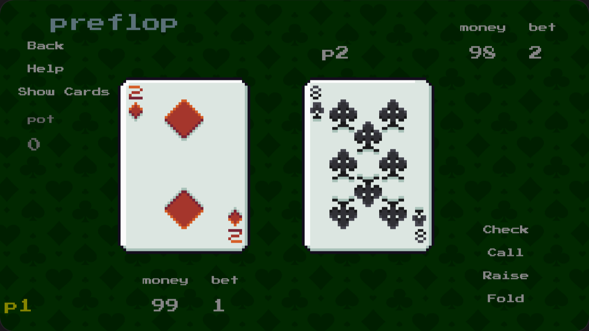
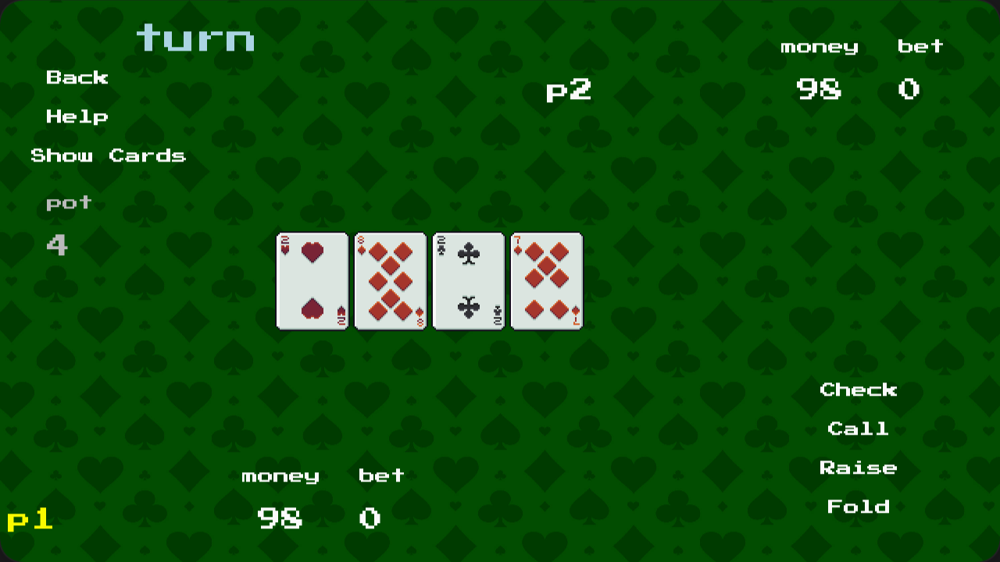
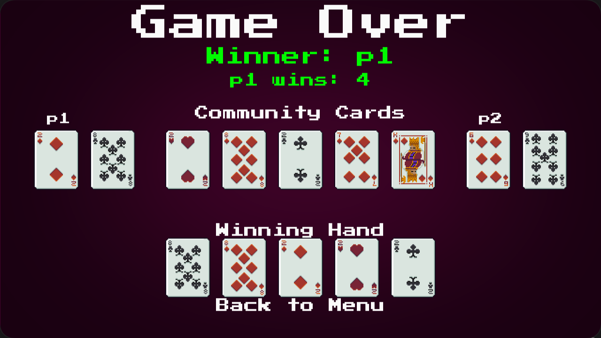

**Heads-up poker game with a neural-network opponent.** Custom hand engine, Pygame interface, model trained on 100,000 generated hands.

<div style="display: flex; flex-wrap: wrap; gap: 8px; margin: 1rem 0;">
  <span style="padding: 4px 12px; border: 1px solid var(--sl-color-gray-5); border-radius: 999px; font-size: 0.85rem;">Python</span>
  <span style="padding: 4px 12px; border: 1px solid var(--sl-color-gray-5); border-radius: 999px; font-size: 0.85rem;">TensorFlow</span>
  <span style="padding: 4px 12px; border: 1px solid var(--sl-color-gray-5); border-radius: 999px; font-size: 0.85rem;">Keras</span>
  <span style="padding: 4px 12px; border: 1px solid var(--sl-color-gray-5); border-radius: 999px; font-size: 0.85rem;">Pygame</span>
  <span style="padding: 4px 12px; border: 1px solid var(--sl-color-gray-5); border-radius: 999px; font-size: 0.85rem;">mypy</span>
</div>

<div style="display: grid; grid-template-columns: repeat(auto-fit, minmax(130px, 1fr)); gap: 12px; margin: 1.5rem 0;">
  <div style="padding: 1rem; border: 1px solid var(--sl-color-gray-5); border-radius: 10px; text-align: center;"><strong style="font-size: 1.7rem;">100,000</strong><br /><small>generated hands</small></div>
  <div style="padding: 1rem; border: 1px solid var(--sl-color-gray-5); border-radius: 10px; text-align: center;"><strong style="font-size: 1.7rem;">3</strong><br /><small>hidden layers</small></div>
  <div style="padding: 1rem; border: 1px solid var(--sl-color-gray-5); border-radius: 10px; text-align: center;"><strong style="font-size: 1.7rem;">80 / 20</strong><br /><small>train / test split</small></div>
  <div style="padding: 1rem; border: 1px solid var(--sl-color-gray-5); border-radius: 10px; text-align: center;"><strong style="font-size: 1.7rem;">0 – 1</strong><br /><small>hand-strength output</small></div>
</div>

[View source on GitHub](https://github.com/Maxim-Koz/Fire-AI-Poker-Project)

---

### How it works

<svg viewBox="0 0 800 140" role="img" aria-label="Pipeline: cards, card encoding, three hidden layers, hand strength between 0 and 1, then action" style="width: 100%; max-width: 800px; height: auto; display: block; margin: 1rem auto; color: inherit;" xmlns="http://www.w3.org/2000/svg">
  <defs>
    <marker id="pk-arrow" viewBox="0 0 10 10" refX="8" refY="5" markerWidth="7" markerHeight="7" orient="auto-start-auto">
      <path d="M0,0 L10,5 L0,10 z" fill="currentColor" />
    </marker>
  </defs>
  <g font-family="system-ui, sans-serif" font-size="14" fill="currentColor" text-anchor="middle">
    <rect x="10" y="35" width="130" height="60" rx="10" fill="none" stroke="currentColor" stroke-opacity="0.5" />
    <text x="75" y="61">Hole cards +</text>
    <text x="75" y="80">board cards</text>
    <line x1="142" y1="65" x2="168" y2="65" stroke="currentColor" stroke-opacity="0.6" marker-end="url(#pk-arrow)" />
    <rect x="170" y="35" width="120" height="60" rx="10" fill="none" stroke="currentColor" stroke-opacity="0.5" />
    <text x="230" y="70">Card encoding</text>
    <line x1="292" y1="65" x2="318" y2="65" stroke="currentColor" stroke-opacity="0.6" marker-end="url(#pk-arrow)" />
    <rect x="320" y="30" width="44" height="70" rx="8" fill="#6366f1" fill-opacity="0.25" stroke="#6366f1" />
    <rect x="376" y="30" width="44" height="70" rx="8" fill="#6366f1" fill-opacity="0.25" stroke="#6366f1" />
    <rect x="432" y="30" width="44" height="70" rx="8" fill="#6366f1" fill-opacity="0.25" stroke="#6366f1" />
    <text x="342" y="70" font-size="12">H1</text>
    <text x="398" y="70" font-size="12">H2</text>
    <text x="454" y="70" font-size="12">H3</text>
    <text x="398" y="124" font-size="12" fill-opacity="0.7">3 hidden layers</text>
    <line x1="478" y1="65" x2="498" y2="65" stroke="currentColor" stroke-opacity="0.6" marker-end="url(#pk-arrow)" />
    <rect x="500" y="35" width="140" height="60" rx="10" fill="#30a46c" fill-opacity="0.25" stroke="#30a46c" />
    <text x="570" y="61">Hand strength</text>
    <text x="570" y="80">0 to 1</text>
    <line x1="642" y1="65" x2="668" y2="65" stroke="currentColor" stroke-opacity="0.6" marker-end="url(#pk-arrow)" />
    <rect x="670" y="35" width="120" height="60" rx="10" fill="none" stroke="currentColor" stroke-opacity="0.5" />
    <text x="730" y="61">Action</text>
    <text x="730" y="80" font-size="12" fill-opacity="0.7">fold / call / raise</text>
  </g>
</svg>

- **Input:** the player's two hole cards plus the current community cards
- **Output:** one number from 0 to 1, the estimated hand strength
- **Training:** 100,000 generated hands, labelled by which hand wins

---

### What I built

<style>
  .pk-built { display: grid; grid-template-columns: repeat(2, minmax(0, 1fr)); gap: 1rem; margin: 1rem 0; }
  @media (max-width: 600px) { .pk-built { grid-template-columns: 1fr; } }
</style>
<div class="pk-built">
  <div style="padding: 1rem; border: 1px solid var(--sl-color-gray-5); border-radius: 10px;">
    <h4 style="margin-top: 0;">Poker engine</h4>
    Card encoding, hand evaluation, and comparison against the community cards.
  </div>
  <div style="padding: 1rem; border: 1px solid var(--sl-color-gray-5); border-radius: 10px;">
    <h4 style="margin-top: 0;">Game interface</h4>
    Pygame UI covering every stage of a hand, chip management and betting.
  </div>
  <div style="padding: 1rem; border: 1px solid var(--sl-color-gray-5); border-radius: 10px;">
    <h4 style="margin-top: 0;">Two game modes</h4>
    Human vs human, or human vs the neural-network bot. Starting chips and big blind are configurable.
  </div>
  <div style="padding: 1rem; border: 1px solid var(--sl-color-gray-5); border-radius: 10px;">
    <h4 style="margin-top: 0;">Neural network</h4>
    TensorFlow/Keras model with 3 hidden layers, trained on an 80/20 split.
  </div>
</div>

---

### Screenshots

 
<style>
  .pk-shots { display: grid; grid-template-columns: repeat(2, minmax(0, 1fr)); gap: 12px; margin: 1rem 0; }
  .pk-shots p { margin: 0; }
  .pk-shots img { width: 100%; height: auto; border: 1px solid var(--sl-color-gray-5); border-radius: 8px; display: block; }
  @media (max-width: 600px) { .pk-shots { grid-template-columns: 1fr; } }
</style>
<div class="pk-shots">


 

 

 

 
</div>


---

### From prediction to action

The bot turned its strength estimate into a move using fixed thresholds.

<svg viewBox="0 0 760 130" role="img" aria-label="Decision thresholds: fold below 0.3, call from 0.3 to 0.5, raise above 0.5" style="width: 100%; max-width: 760px; height: auto; display: block; margin: 1rem auto; color: inherit;" xmlns="http://www.w3.org/2000/svg">
  <g font-family="system-ui, sans-serif" font-size="14" fill="currentColor" text-anchor="middle">
    <rect x="20" y="25" width="216" height="46" rx="6" fill="#e5484d" fill-opacity="0.3" stroke="#e5484d" />
    <rect x="236" y="25" width="144" height="46" rx="0" fill="#f5a524" fill-opacity="0.3" stroke="#f5a524" />
    <rect x="380" y="25" width="360" height="46" rx="6" fill="#30a46c" fill-opacity="0.3" stroke="#30a46c" />
    <text x="128" y="53">Fold</text>
    <text x="308" y="53">Call</text>
    <text x="560" y="53">Raise (size scales with strength)</text>
    <g font-size="12" fill-opacity="0.75">
      <text x="20" y="95">0</text>
      <text x="236" y="95">0.3</text>
      <text x="380" y="95">0.5</text>
      <text x="740" y="95">1.0</text>
      <text x="380" y="118">predicted hand strength</text>
    </g>
  </g>
</svg>

---

### What I learned

<div style="padding: 1rem 1.25rem; border-left: 4px solid #6366f1; background: rgba(99, 102, 241, 0.08); border-radius: 6px; margin: 1rem 0;">
  <strong>Hand strength alone does not decide the best action.</strong> The right move also depends on what it costs to continue and what there is to win.
</div>

- Test accuracy came in lower than I had hoped
- Fixed thresholds ignore the price of a call, so the same hand is always played the same way
- A better bot should compare **cost** against **reward**, which is what pot odds do

#### Pot odds, worked example

<svg viewBox="0 0 760 170" role="img" aria-label="Pot of 100, call of 50: break-even win chance is 50 divided by 150, which is 33 percent" style="width: 100%; max-width: 760px; height: auto; display: block; margin: 1rem auto; color: inherit;" xmlns="http://www.w3.org/2000/svg">
  <g font-family="system-ui, sans-serif" font-size="14" fill="currentColor" text-anchor="middle">
    <rect x="20" y="20" width="480" height="46" rx="6" fill="#6366f1" fill-opacity="0.25" stroke="#6366f1" />
    <rect x="500" y="20" width="240" height="46" rx="6" fill="#f5a524" fill-opacity="0.3" stroke="#f5a524" />
    <text x="260" y="48">Pot: 100</text>
    <text x="620" y="48">Cost to call: 50</text>
    <text x="380" y="98" font-size="16" font-weight="600">Break-even win chance = 50 / (100 + 50) = 33%</text>
    <text x="380" y="126" font-size="13" fill-opacity="0.8">Fixed thresholds treat every 0.35 hand the same, whatever the bet.</text>
    <text x="380" y="148" font-size="13" fill-opacity="0.8">Pot odds make the decision depend on the price.</text>
  </g>
</svg>

---

### Next steps

- Add **pot odds** to betting decisions
- Compare actions by **expected value** instead of fixed cut-offs
- Improve model training and evaluation

---

### What I took away

My first major Python project, built for my Computer Science NEA under time constraints. The bot is deliberately simple, and the decision logic is the part I'd most like to rebuild.

- Structuring a larger codebase
- Static typing with **mypy** and debugging with **log files**
- Better git habits
- Building and training a simple neural network

---

### Try it

```bash
git clone https://github.com/Maxim-Koz/Fire-AI-Poker-Project
cd Fire-AI-Poker-Project
pip install -r requirements.txt
python main.py
```

---

### Source code

[View Fire-AI-Poker-Project on GitHub](https://github.com/Maxim-Koz/Fire-AI-Poker-Project)