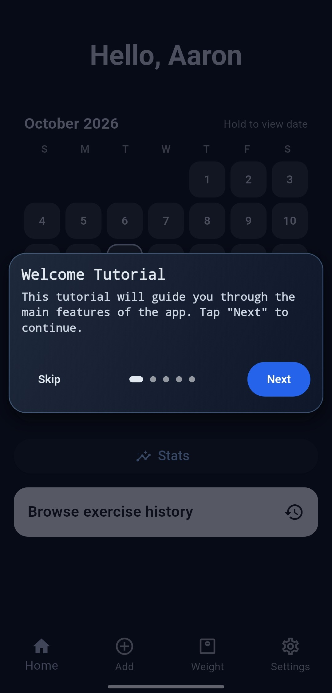
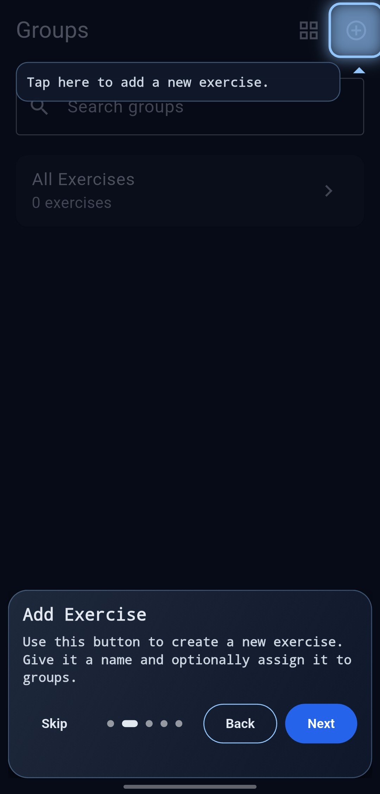
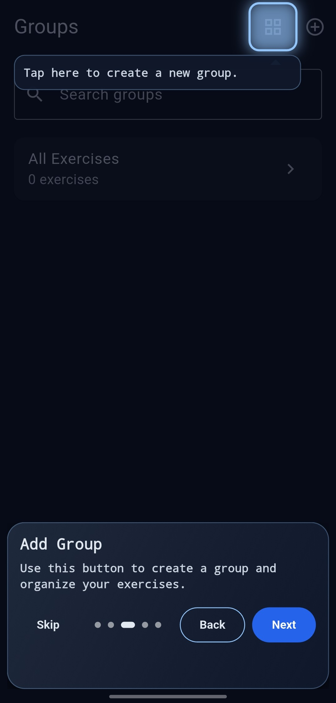
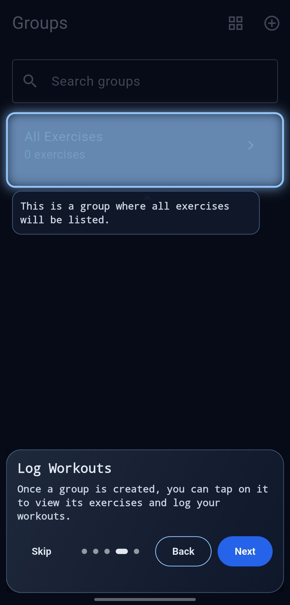

**A lightweight gym rep tracker built with Flutter.** Log weight and reps, see what you lifted last time, track progress. No subscriptions, no paywalled features.

  Dart
  Flutter
  Android
  Google Play
  Open source

  
<strong style="font-size: 1.7rem;">Live</strong> <small>closed testing on Google Play</small>

  
<strong style="font-size: 1.7rem;">0</strong> <small>subscriptions or paywalls</small>

  
<strong style="font-size: 1.7rem;">No limit</strong> <small>custom exercises and routines</small>

  
<strong style="font-size: 1.7rem;">GPL-3.0</strong> <small>licence</small>

[View source on GitHub](https://github.com/Maxim-Koz/REPLACE-WITH-REPTR-REPO)

---

### The problem

You are about to load the bar for your top set and cannot remember what you lifted last session. It breaks your rhythm and makes it hard to progress.

Most apps that solve this put basic features behind a subscription or cap how many exercises and routines you can create. Reptr does neither.

---

### How it works

<svg viewBox="0 0 800 140" role="img" aria-label="Flow: pick exercise, see last session, log sets, saved history, progress and personal best" style="width: 100%; max-width: 800px; height: auto; display: block; margin: 1rem auto; color: inherit;" xmlns="http://www.w3.org/2000/svg">
  <defs>
    <marker id="rp-arrow" viewBox="0 0 10 10" refX="8" refY="5" markerWidth="7" markerHeight="7" orient="auto-start-auto">
      <path d="M0,0 L10,5 L0,10 z" fill="currentColor" />
    </marker>
  </defs>
  <g font-family="system-ui, sans-serif" font-size="14" fill="currentColor" text-anchor="middle">
    <rect x="10" y="35" width="130" height="60" rx="10" fill="none" stroke="currentColor" stroke-opacity="0.5" />
    <text x="75" y="61">Pick an</text>
    <text x="75" y="80">exercise</text>
    <line x1="142" y1="65" x2="168" y2="65" stroke="currentColor" stroke-opacity="0.6" marker-end="url(#rp-arrow)" />
    <rect x="170" y="35" width="140" height="60" rx="10" fill="#6366f1" fill-opacity="0.25" stroke="#6366f1" />
    <text x="240" y="61">See last</text>
    <text x="240" y="80">session</text>
    <line x1="312" y1="65" x2="338" y2="65" stroke="currentColor" stroke-opacity="0.6" marker-end="url(#rp-arrow)" />
    <rect x="340" y="35" width="130" height="60" rx="10" fill="none" stroke="currentColor" stroke-opacity="0.5" />
    <text x="405" y="61">Log weight</text>
    <text x="405" y="80">and reps</text>
    <line x1="472" y1="65" x2="498" y2="65" stroke="currentColor" stroke-opacity="0.6" marker-end="url(#rp-arrow)" />
    <rect x="500" y="35" width="120" height="60" rx="10" fill="none" stroke="currentColor" stroke-opacity="0.5" />
    <text x="560" y="61">Saved to</text>
    <text x="560" y="80">history</text>
    <line x1="622" y1="65" x2="648" y2="65" stroke="currentColor" stroke-opacity="0.6" marker-end="url(#rp-arrow)" />
    <rect x="650" y="35" width="140" height="60" rx="10" fill="#30a46c" fill-opacity="0.25" stroke="#30a46c" />
    <text x="720" y="61">Graphs and</text>
    <text x="720" y="80">personal best</text>
    <path d="M720 100 V122 H240 V97" fill="none" stroke="currentColor" stroke-opacity="0.4" stroke-dasharray="4 4" marker-end="url(#rp-arrow)" />
    <text x="480" y="118" font-size="12" fill-opacity="0.7" dy="-6">next session starts from what you did last time</text>
  </g>
</svg>

---

### What I built

  

    <h4 style="margin-top: 0;">Set logging</h4>
    Weight and reps for every exercise, including rest-pause sets and drop sets.
  

  

    <h4 style="margin-top: 0;">Progress tracking</h4>
    Per-exercise progress graphs and a personal best weight for each lift.
  

  

    <h4 style="margin-top: 0;">Calendar view</h4>
    See at a glance which days you trained.
  

  

    <h4 style="margin-top: 0;">Body-weight tracking</h4>
    Check whether a diet change is working, or record body weight for exercises like pull-ups.
  

---

### Beyond straight sets

Real training is not always "3 sets of 8 at the same weight". Reptr logs the awkward cases too.

<svg viewBox="0 0 760 335" role="img" aria-label="Three set types on one scale. Straight sets: same weight with full rest. Drop set: weight falls with no rest. Rest-pause: same weight with short rests and fewer reps each time." style="width: 100%; max-width: 760px; height: auto; display: block; margin: 1rem auto; color: inherit;" xmlns="http://www.w3.org/2000/svg"> <g font-family="system-ui, sans-serif" font-size="14" fill="currentColor" text-anchor="middle"> <text x="10" y="18" font-size="12" fill-opacity="0.7" text-anchor="start">Bar height = weight</text> <text x="215" y="18" font-size="12" fill-opacity="0.7" text-anchor="start">Bar width = reps</text> <text x="410" y="18" font-size="12" fill-opacity="0.7" text-anchor="start">Gap = rest</text> <text x="540" y="18" font-size="12" fill-opacity="0.7" text-anchor="start">Labels = kg × reps</text> <line x1="10" y1="32" x2="750" y2="32" stroke="currentColor" stroke-opacity="0.15" /> <text x="10" y="76" font-weight="600" text-anchor="start">Straight sets</text> <text x="10" y="96" font-size="12" fill-opacity="0.7" text-anchor="start">same weight, full rest</text> <line x1="170" y1="105" x2="750" y2="105" stroke="currentColor" stroke-opacity="0.3" /> <rect x="170" y="57" width="80" height="48" rx="4" fill="#6366f1" fill-opacity="0.3" stroke="#6366f1" /> <rect x="300" y="57" width="80" height="48" rx="4" fill="#6366f1" fill-opacity="0.3" stroke="#6366f1" /> <rect x="430" y="57" width="80" height="48" rx="4" fill="#6366f1" fill-opacity="0.3" stroke="#6366f1" /> <text x="210" y="50" font-size="12">80×8</text> <text x="340" y="50" font-size="12">80×8</text> <text x="470" y="50" font-size="12">80×8</text> <text x="275" y="100" font-size="11" fill-opacity="0.6">rest</text> <text x="405" y="100" font-size="11" fill-opacity="0.6">rest</text> <line x1="10" y1="122" x2="750" y2="122" stroke="currentColor" stroke-opacity="0.15" /> <text x="10" y="182" font-weight="600" text-anchor="start">Drop set</text> <text x="10" y="202" font-size="12" fill-opacity="0.7" text-anchor="start">weight falls, no rest</text> <line x1="170" y1="215" x2="750" y2="215" stroke="currentColor" stroke-opacity="0.3" /> <rect x="170" y="155" width="60" height="60" rx="4" fill="#f5a524" fill-opacity="0.3" stroke="#f5a524" /> <rect x="230" y="167" width="60" height="48" rx="4" fill="#f5a524" fill-opacity="0.3" stroke="#f5a524" /> <rect x="290" y="179" width="80" height="36" rx="4" fill="#f5a524" fill-opacity="0.3" stroke="#f5a524" /> <text x="200" y="148" font-size="12">100×6</text> <text x="260" y="160" font-size="12">80×6</text> <text x="330" y="172" font-size="12">60×8</text> <line x1="10" y1="232" x2="750" y2="232" stroke="currentColor" stroke-opacity="0.15" /> <text x="10" y="278" font-weight="600" text-anchor="start">Rest-pause</text> <text x="10" y="298" font-size="12" fill-opacity="0.7" text-anchor="start">same weight, short rests</text> <line x1="170" y1="307" x2="750" y2="307" stroke="currentColor" stroke-opacity="0.3" /> <rect x="170" y="259" width="80" height="48" rx="4" fill="#30a46c" fill-opacity="0.3" stroke="#30a46c" /> <rect x="262" y="259" width="20" height="48" rx="4" fill="#30a46c" fill-opacity="0.3" stroke="#30a46c" /> <text x="210" y="252" font-size="12">80×8</text> <text x="272" y="252" font-size="12">80×2</text> <text x="640" y="325" font-size="11" fill-opacity="0.6">Example numbers, not real data</text> </g> </svg>

---

### Screenshots

---

### What I took away

  <strong>Building for real users is different from building for a marking scheme.</strong> Reptr is distributed through Google Play closed testing, so it has to work on other people's phones, not just mine.

- Shipping a Flutter app from first commit to Google Play testing
- Designing around a real workflow: fast logging between sets
- Releasing as open source under GPL-3.0

---

### Try it

Reptr is in closed testing on Google Play. To request access, email [minimsgymtracker@gmail.com](mailto:minimsgymtracker@gmail.com) with the Google account email you use for Google Play. You will be added as a tester and sent a link to join.

---

### Source code

[View Reptr on GitHub](https://github.com/Maxim-Koz/REPLACE-WITH-REPTR-REPO)